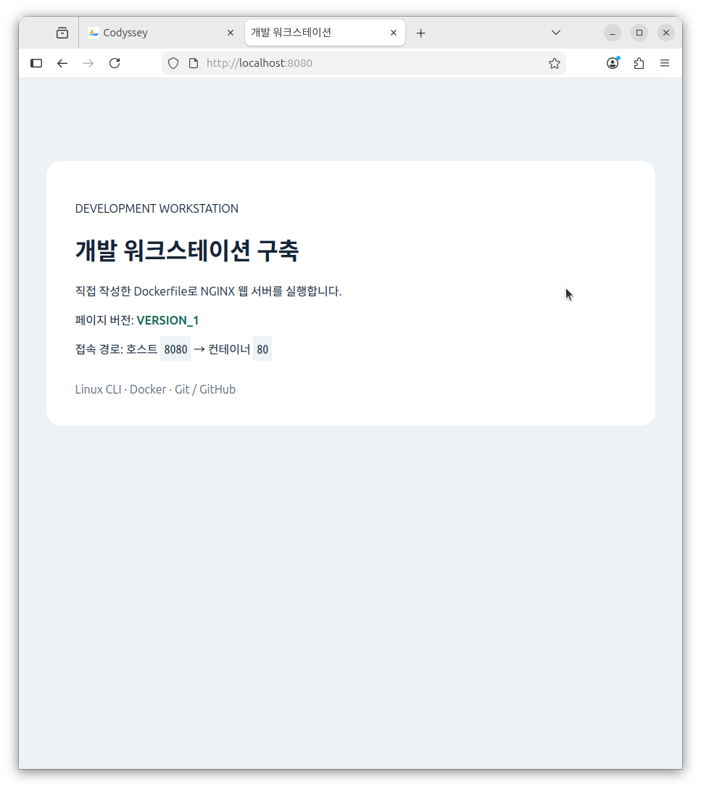
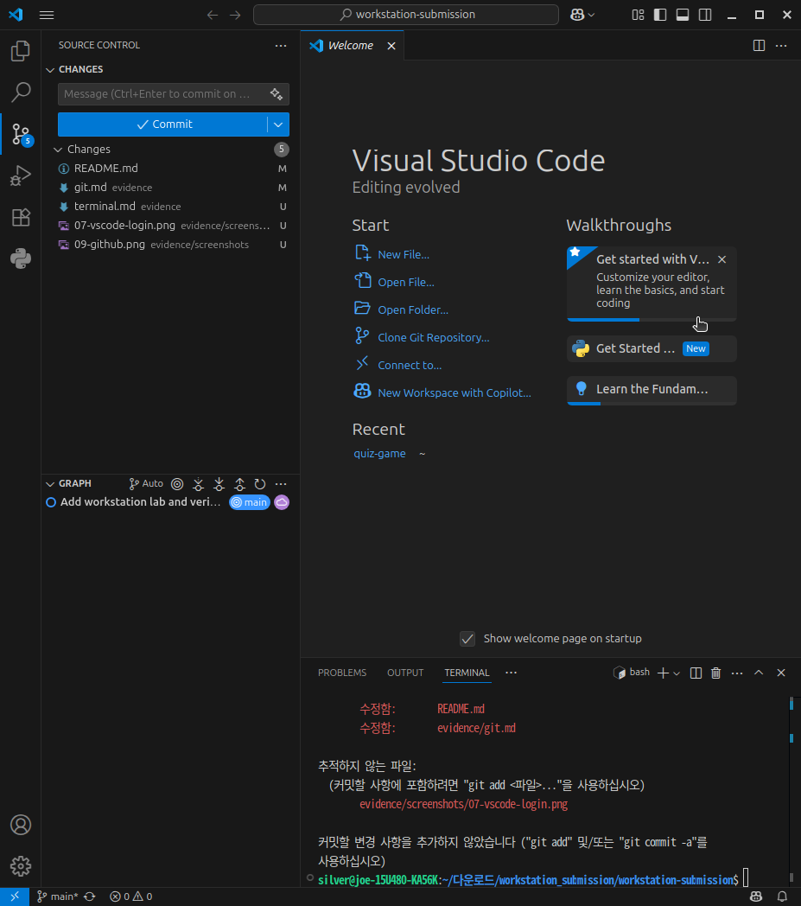
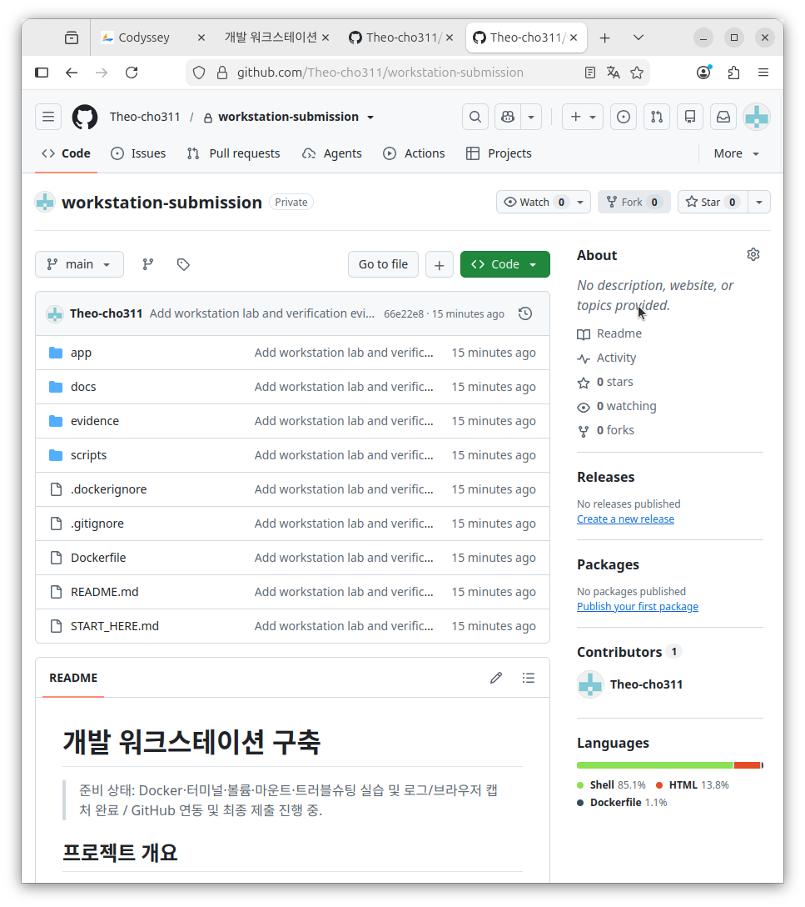

# 개발 워크스테이션 구축

## 1. 프로젝트 개요

로컬 개발 환경이 특정 PC에만 종속되는 문제를 해결하고, 누구나 동일한 방식으로 서비스를 빌드·실행·검증할 수 있는 **재현 가능한 개발 워크스테이션**을 구축한다.

- **Linux CLI (터미널):** 디렉터리/파일 조작 및 `chmod` 기반 접근 권한(`r/w/x`) 제어
- **Docker 컨테이너:** `nginx:stable-alpine` 기반 커스텀 이미지 제작, 포트 매핑(`8080:80`), 바인드 마운트(실시간 반영), Docker 볼륨(컨테이너 삭제 후 데이터 영속성) 검증
- **Git / GitHub:** 버전 관리 초기화, 민감정보 마스킹 및 VS Code 연동 원격 저장소 배포

---

## 2. 실행 환경

| 항목 | 상세 사양 |
|---|---|
| **OS / 커널** | Ubuntu 24.04.3 LTS (`Linux 6.8.0-63-generic x86_64`) |
| **셸 / 터미널** | GNU bash `5.2.21(1)-release` (`/bin/bash`) |
| **Docker 버전** | Docker Engine - Community `27.4.1` (build `b9d17ea`) |
| **Git 버전** | `git version 2.43.0` |
| **저장소 URL** | [https://github.com/Theo-cho311/workstation-submission](https://github.com/Theo-cho311/workstation-submission) |

---

## 3. 수행 항목 체크리스트

- [x] **터미널 조작:** 현재 위치(`pwd`), 숨김 포함 목록(`ls -la`), 생성·복사·이름 변경·삭제(`mkdir`, `touch`, `cp`, `mv`, `rm`), 내용 확인(`cat`)
- [x] **권한 실험:** 파일(`600` → `644`) 및 디렉터리(`700` → `755`) 권한 변경 전후 `ls -ld` 비교
- [x] **Docker 점검:** `docker --version`, `docker info` 데몬 연결 확인 및 `hello-world` 실행
- [x] **컨테이너 수명주기:** `ubuntu:24.04` 내부 진입(`run -it`), 추가 셸(`exec -it`), 재연결 및 분리(`start -ai`, `Ctrl+P` → `Ctrl+Q`) 차이 관찰
- [x] **컨테이너 운영:** `images`, `ps`, `ps -a`, `logs`, `stats`, `stop`, `start` 수행
- [x] **커스텀 이미지:** `Dockerfile` 직접 작성 및 `workstation-web:1.0` 빌드·실행
- [x] **포트 매핑:** `-p 127.0.0.1:8080:80` 실행 후 `curl` 응답 및 브라우저 접속 확인
- [x] **바인드 마운트:** 호스트 `app/index.html` 수정(`VERSION_1` → `VERSION_2`) 시 컨테이너 재시작 없이 즉시 반영 확인
- [x] **Docker 볼륨:** `ws-data` 볼륨 생성 및 컨테이너 삭제(`docker rm`) 후 신규 컨테이너에서 데이터 유지 증명
- [x] **트러블슈팅 2건:** 파일 읽기 권한 거부(`chmod 000`) 및 컨테이너 이름 충돌(`Conflict`) 재현·해결 기록
- [x] **Git / GitHub 연동:** 사용자 정보·기본 브랜치(`main`) 설정, VS Code GitHub 인증 및 원격 푸시 완료

---

## 4. 커스텀 이미지 설계 및 실행 방법

### 4.1 커스텀 이미지 구성

- **베이스 이미지:** `nginx:stable-alpine` (경량 Alpine 기반 공식 NGINX 이미지 활용)
- **커스텀 포인트 ([`Dockerfile`](Dockerfile)):**
  ```dockerfile
  FROM nginx:stable-alpine
  COPY app/ /usr/share/nginx/html/
  EXPOSE 80
  ```
  - `FROM nginx:stable-alpine`: 정적 웹 서버 환경을 베이스로 사용
  - `COPY app/ /usr/share/nginx/html/`: 호스트의 웹 페이지 소스([`app/index.html`](app/index.html))를 컨테이너 내부 서빙 경로로 복사
  - `EXPOSE 80`: 컨테이너 내부 수신 포트(`80/tcp`) 명시

### 4.2 빌드 및 실행 명령어

```bash
# 1. 커스텀 이미지 빌드
docker build -t workstation-web:1.0 .

# 2. 포트 매핑(호스트 8080 -> 컨테이너 80)으로 컨테이너 실행
docker run -d --name ws-web -p 127.0.0.1:8080:80 workstation-web:1.0

# 3. 동작 확인
curl -i http://localhost:8080
```

---

## 5. 항목별 검증 방법 및 결과 로그

| 검증 영역 | 수행 명령어 | 결과 로그 |
|---|---|---|
| **환경 점검** | `docker --version`, `docker info`, `git --version`, `uname -a` | [`evidence/env.md`](evidence/env.md) |
| **터미널 / 권한** | `pwd`, `ls -la`, `mkdir`, `touch`, `cp`, `mv`, `rm`, `chmod`, `ls -ld` | [`evidence/terminal.md`](evidence/terminal.md) |
| **Docker 기본 운영** | `pull`, `run hello-world`, `images`, `ps -a`, `logs`, `stats` | [`evidence/docker.md`](evidence/docker.md) |
| **내부 진입 / 수명주기** | `run -it`, `exec -it`, `start -ai`, `exit` 및 `Ctrl+P, Q` 분리 | [`evidence/interactive.md`](evidence/interactive.md) |
| **이미지 빌드 / 포트** | `docker build`, `run -p 127.0.0.1:8080:80`, `docker port`, `curl -i` | [`evidence/web.md`](evidence/web.md) |
| **바인드 마운트** | `--mount type=bind`, 호스트 파일 수정 전(`VERSION_1`)·후(`VERSION_2`) 확인 | [`evidence/mount.md`](evidence/mount.md) |
| **Docker 볼륨** | `volume create ws-data`, 컨테이너 삭제(`rm`) 전후 `/data/proof.txt` 비교 | [`evidence/volume.md`](evidence/volume.md) |
| **트러블슈팅 (2건)** | 파일 권한 오류(`chmod 000`) 및 컨테이너 이름 중복(`Conflict`) 해결 | [`docs/troubleshooting.md`](docs/troubleshooting.md) · [`evidence/trouble.md`](evidence/trouble.md) |
| **Git / GitHub 연동** | `git config --list`, `remote -v`, `branch -vv`, `status`, `log` | [`evidence/git.md`](evidence/git.md) |

---

## 6. 핵심 검증 결과 요약

- **웹 서버 빌드 및 포트 매핑:** `workstation-web:1.0` 이미지를 빌드하고 `127.0.0.1:8080:80`으로 실행하여 `HTTP/1.1 200 OK` 응답과 브라우저 화면(`VERSION_1`)을 확인함.
- **바인드 마운트 실시간 반영:** 동일 컨테이너(`ws-bind`)가 실행 중인 상태에서 호스트의 `app/index.html`을 수정하자 이미지 재빌드 없이 즉시 `VERSION_2`가 반환됨을 확인함.
- **Docker 볼륨 영속성:** `ws-data` 볼륨에 `persistent-data-2026`을 기록한 뒤 기존 컨테이너(`ws-data-before`)를 삭제(`docker rm`)하고, 새 컨테이너(`ws-data-after`)에 동일 볼륨을 연결해 데이터가 그대로 유지됨을 확인함.
- **컨테이너 프로세스 수명 관찰:** 주 프로세스(`bash`)에서 `exit`하면 컨테이너가 `Exited`되지만, `docker exec`로 연 보조 셸에서 `exit`하거나 `Ctrl+P, Ctrl+Q`로 분리하면 컨테이너가 `Up` 상태를 유지함을 확인함.
- **트러블슈팅 2건 해결:**
  1. `practice/locked.txt` 권한 `000` 상태에서 발생한 `허가 거부` 오류를 `chmod 644`로 해결.
  2. 종료된 `ws-name-test` 컨테이너로 인한 이름 충돌(`Conflict`)을 `docker rm ws-name-test`로 정리 후 재실행하여 해결.

---

## 7. 화면 캡처 증거

### 7.1 포트 매핑 웹 서버 접속 (`http://localhost:8080`)


### 7.2 바인드 마운트 호스트 파일 수정 전 (`VERSION_1`) / 후 (`VERSION_2`)
| 변경 전 (`VERSION_1`) | 변경 후 (`VERSION_2`) |
|---|---|
|  |  |

### 7.3 VS Code GitHub 인증 및 저장소 연동
| VS Code GitHub 로그인 | VS Code 저장소 연동 |
|---|---|
|  |  |

### 7.4 GitHub 원격 저장소

