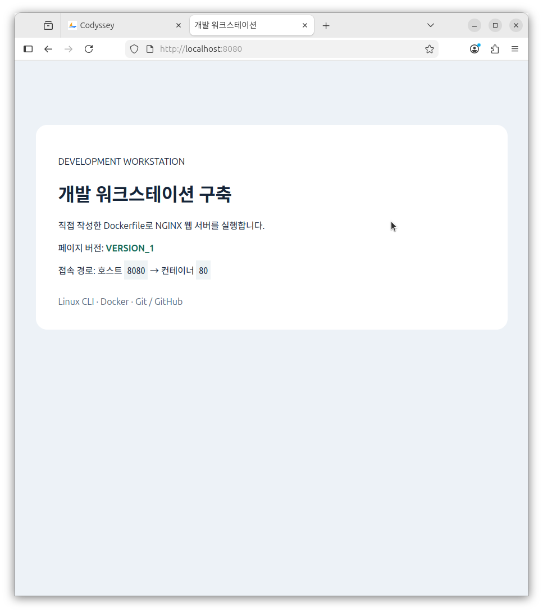

# 개발 워크스테이션 구축

> 준비 상태: Docker·터미널·볼륨·마운트·트러블슈팅 실습 및 로그/브라우저 캡처 완료 / GitHub 연동 및 최종 제출 진행 중.

## 프로젝트 개요

터미널로 파일과 권한을 다루고, NGINX 기반 커스텀 이미지를 만들어 정적 웹 서버를 실행한다. 포트 매핑, 바인드 마운트의 즉시 변경 반영, 볼륨의 데이터 영속성을 검증하고 Git/GitHub로 코드와 수행 증거를 관리한다.

## 실행 환경

| 항목 | 실제 값 |
|---|---|
| OS / 버전 | Ubuntu 24.04.3 LTS (Linux 6.8.0-63-generic x86_64) |
| 호스트 OS 및 WSL 여부 | 네이티브 Linux (WSL 아님) |
| 셸 / 터미널 앱 | GNU bash 5.2.21(1)-release (`/bin/bash`) |
| Docker 버전 / 실행 환경 | Docker Engine - Community 27.4.1 (build b9d17ea) |
| Git 버전 | git version 2.43.0 |
| 실습 일시 | 2026-11-17 19:40 ~ 20:25 KST |
| 저장소 URL | [GitHub 연동 후 입력] |

버전과 엔진 정보: [환경 로그](evidence/env.md). 개인 PC 절대 경로 대신 프로젝트 루트와 `$(pwd)`를 사용한다.

## 수행 체크리스트

실제 검증이 끝난 항목만 `[x]`로 변경한다.

- [x] 현재 위치·숨김 파일 목록·이동·생성·복사·이름 변경·삭제·내용 확인·빈 파일 생성
- [x] 파일 1개와 디렉터리 1개 권한 변경 전후 확인
- [x] Docker 설치/연결 점검 및 hello-world 성공
- [x] Ubuntu 내부 진입과 exec/attach/종료 차이 관찰
- [x] 이미지·컨테이너·로그·리소스 운영 명령 수행
- [x] Dockerfile 직접 작성 및 커스텀 이미지 빌드/실행
- [x] 포트 매핑 및 curl·브라우저 접속 확인
- [x] 바인드 마운트 변경 전후 확인
- [x] 컨테이너 삭제 전후 볼륨 데이터 유지 확인
- [x] 트러블슈팅 2건 재현·해결·기록
- [ ] Git 사용자 정보·기본 브랜치 설정
- [ ] VS Code GitHub 로그인·저장소 연동·최종 푸시
- [ ] 민감정보 검수 및 모든 증거 링크 접근 확인

## 소스와 실행 방법

- [웹 서버 소스](app/index.html)
- [직접 작성할 Dockerfile](Dockerfile)
- [처음부터 실습하는 절차](START_HERE.md)
- [검증 도우미 명령 소스](scripts/lab.sh)

선택 방식: 요구사항 A, 기존 NGINX 웹 서버 이미지 활용. 베이스는 `nginx:stable-alpine`이다. 기본 페이지를 한글 페이지로 교체하고 버전 표식을 추가해 변경 반영을 관찰한다. EXPOSE로 내부 포트를 명시한다. 베이스의 기본 실행 명령을 사용한다.

Docker가 준비된 환경에서 저장소를 복제하여 프로젝트 루트로 이동한 후 웹 서버만 재현하려면:

```bash
docker build -t workstation-web:1.0 .
docker run -d --name ws-web -p 127.0.0.1:8080:80 workstation-web:1.0
curl -i http://localhost:8080
```

브라우저 주소: `http://localhost:8080`. 이미 같은 이름을 사용했다면 기존 실습 컨테이너 상태를 확인한다. 포트가 사용 중이면 호스트 포트만 바꾸고 접속 주소도 함께 수정한다. 전체 요구사항은 START_HERE 순서대로 검증한다.

이미지 태그는 변경될 수 있으므로 빌드 로그에 실제 이미지 ID와 베이스 RepoDigest를 기록한다. 엄격한 베이스 고정이 필요하면 해당 digest를 FROM에 적용한 뒤 재빌드한다.

## 검증 방법과 실제 증거

아래 로그는 실제 실습 실행 후 생성된다. 존재하지 않는 링크는 아직 수행되지 않은 항목이다.

| 항목 | 검증 명령/관찰 | 실제 증거 |
|---|---|---|
| 환경 | docker --version, docker info, git --version | [환경](evidence/env.md) |
| 터미널/권한 | pwd, ls -la, cd, mkdir, touch, cat, cp, mv, rm, chmod, ls -ld | [터미널](evidence/terminal.md) |
| Docker 기본 | pull, run hello-world, images, ps -a, logs, stats, stop/start | [운영](evidence/docker.md) |
| 내부 진입/수명 | run -it, exec -it, start -ai, exit와 분리 키 | [대화형](evidence/interactive.md) |
| 이미지/포트 | build, run -p, docker port, curl, logs | [웹 서버](evidence/web.md) |
| 바인드 마운트 | --mount type=bind, 호스트 수정 전후 curl | [마운트](evidence/mount.md) |
| 볼륨 | volume create, /data 기록, rm 후 새 컨테이너에서 cat | [볼륨](evidence/volume.md) |
| 오류 해결 | 권한 오류와 이름 충돌 재현 | [해결 설명](docs/troubleshooting.md), [실제 로그](evidence/trouble.md) |
| Git/GitHub | config --list, remote -v, branch -vv, status, log | [Git 로그](evidence/git.md), [연동 절차](docs/github.md) |

## 화면 증거

실제 파일을 저장한 뒤 아래 링크가 정상 표시되는지 확인한다. 상세 촬영 시점은 [캡처 안내](docs/screenshots.md)를 따른다.





## 결과 요약

- 웹 서버 HTTP 응답 및 페이지: `workstation-web:1.0` 빌드 후 `127.0.0.1:8080:80` 매핑, `curl` HTTP/1.1 200 OK 응답 및 브라우저 접속(`VERSION_1`) 확인 ([웹 서버 로그](evidence/web.md))
- 같은 컨테이너에서 호스트 파일 수정 반영: `ws-bind` 컨테이너 실행 중 호스트 `app/index.html`의 `VERSION_1` → `VERSION_2` 변경 시 즉시 반영 확인 ([마운트 로그](evidence/mount.md))
- 기존 컨테이너 삭제 후 새 컨테이너에서 동일 볼륨 데이터 확인: `ws-data` 볼륨에 `persistent-data-2026` 기록 후 `ws-data-before` 삭제(`rm`) 뒤 `ws-data-after`에서 동일 파일 조회 성공 ([볼륨 로그](evidence/volume.md))
- exec/attach/exit 관찰: 주 프로세스(`bash`) 종료 시 `Exited`, `exec` 보조 셸 종료 시 `Up` 유지, `attach` 후 `Ctrl+P, Ctrl+Q` 분리 시 `Up` 유지 확인 ([대화형 로그](evidence/interactive.md))
- 트러블슈팅 2건 해결: `chmod 000` 권한 오류(`허가 거부` → `chmod 644`), `ws-name-test` 이름 충돌(`Conflict` → `docker rm`) 재현 및 해결 ([트러블슈팅](docs/troubleshooting.md), [실제 로그](evidence/trouble.md))

## 핵심 개념과 평가 준비

[평가 질문·답변 20개](docs/evaluation-qa.md)에서 절대/상대 경로, 권한, 이미지/컨테이너, 포트, 마운트/볼륨, Git/GitHub를 설명한다.

선택 보너스는 이번 제출 준비 범위에 포함하지 않았다. 필수 요구사항 완료를 우선한다.

## 참고 공식 문서

- [Docker Ubuntu 설치](https://docs.docker.com/engine/install/ubuntu/)
- [Docker 컨테이너 실행](https://docs.docker.com/engine/containers/run/)
- [바인드 마운트](https://docs.docker.com/engine/storage/bind-mounts/)
- [볼륨](https://docs.docker.com/engine/storage/volumes/)
- [VS Code GitHub 연동](https://code.visualstudio.com/docs/sourcecontrol/github)
