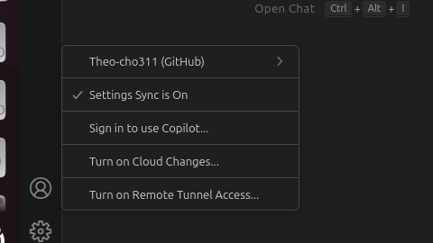

# 개발 워크스테이션 구축

## 1. 프로젝트 개요

로컬 개발 환경이 특정 PC에만 종속되는 문제를 해결하고, 누구나 동일한 방식으로 서비스를 빌드·실행·검증할 수 있는 **재현 가능한 개발 워크스테이션**을 구축한다.

- **Linux CLI (터미널):** 디렉터리/파일 조작 및 `chmod` 기반 접근 권한(`r/w/x`) 제어
- **Docker 컨테이너:** `nginx:stable-alpine` 기반 커스텀 이미지 제작, 포트 매핑(`8080:80`), 바인드 마운트(실시간 반영), Docker 볼륨(컨테이너 삭제 후 데이터 영속성) 검증
- **Git / GitHub:** 버전 관리 초기화, 민감정보 마스킹 및 VS Code 연동 원격 저장소 배포

---

## 2. 실행 환경

| 항목 | 상세 사양 |
|---|---|
| **OS / 커널** | Ubuntu 24.04.3 LTS (`Linux 6.8.0-63-generic x86_64`) |
| **셸 / 터미널** | GNU bash `5.2.21(1)-release` (`/bin/bash`) |
| **Docker 버전** | Docker Engine - Community `27.4.1` (build `b9d17ea`) |
| **Git 버전** | `git version 2.43.0` |
| **저장소 URL** | [https://github.com/Theo-cho311/workstation-submission](https://github.com/Theo-cho311/workstation-submission) |

---

## 3. 디렉토리 구조 및 설계 기준

### 3.1 디렉토리 설계 기준
애플리케이션 소스(`app/`), 컨테이너 빌드 명세(`Dockerfile`), 기술 문서(`docs/`), 실행 검증 증거(`evidence/`)를 역할별로 엄격히 분리(관심사 분리, Separation of Concerns)하여 설계하였다. 이를 통해 `.dockerignore`로 불필요한 문서·로그가 이미지 빌드 컨텍스트에 포함되는 것을 방지하고, 코드와 검증 산출물의 유지보수성 및 재현성을 높였다.

### 3.2 폴더 및 주요 파일별 역할

```text
workstation-submission/
├── Dockerfile              # NGINX 기반 커스텀 웹 서버 이미지 빌드 정의서
├── README.md               # 프로젝트 개요, 설계 기준, 검증 방법 및 결과 종합 문서
├── app/                    # 컨테이너가 서빙할 정적 웹 애플리케이션 소스 폴더
│   └── index.html          # 웹 서버 메인 페이지 (버전 표식 포함)
├── docs/                   # 트러블슈팅 및 심화 기술 문서 폴더
│   └── troubleshooting.md  # 권한 오류 및 컨테이너 이름 충돌 해결 기록
├── evidence/               # CLI 명령어 실제 실행 로그 및 화면 캡처 보관 폴더
│   ├── *.md                # 단계별 명령어 입력 및 출력 원본 로그
│   └── screenshots/        # 브라우저 접속, 마운트 전후, VS Code/GitHub 연동 캡처 이미지
└── scripts/                # 실습 검증 및 로그 기록 자동화 스크립트 폴더
    └── lab.sh              # 단계별 검증 명령 실행 스크립트
```

| 경로 (폴더/파일) | 목적 및 역할 (한 줄 요약) |
|---|---|
| `app/` | NGINX 컨테이너 내부(`/usr/share/nginx/html`)로 복사되거나 바인드 마운트되는 정적 웹 소스 디렉토리 |
| `docs/` | 실습 중 재현한 트러블슈팅(원인 가설·검증·해결) 및 운영 문서를 관리하는 디렉토리 |
| `evidence/` | 터미널/Docker/Git 명령의 실제 입출력 로그(`.md`)와 화면 증거(`screenshots/*.png`)를 분리 보관하는 디렉토리 |
| `scripts/` | 동일한 검증 절차를 반복 재현할 수 있도록 구성한 셸 스크립트 디렉토리 |
| `Dockerfile` | 베이스 이미지(`nginx:stable-alpine`), 소스 복사(`COPY`), 노출 포트(`EXPOSE 80`)를 정의한 빌드 명세 파일 |

---

## 3. 수행 항목 체크리스트

- [x] **터미널 조작:** 현재 위치(`pwd`), 숨김 포함 목록(`ls -la`), 생성·복사·이름 변경·삭제(`mkdir`, `touch`, `cp`, `mv`, `rm`), 내용 확인(`cat`)
- [x] **권한 실험:** 파일(`600` → `644`) 및 디렉터리(`700` → `755`) 권한 변경 전후 `ls -ld` 비교
- [x] **Docker 점검:** `docker --version`, `docker info` 데몬 연결 확인 및 `hello-world` 실행
- [x] **컨테이너 수명주기:** `ubuntu:24.04` 내부 진입(`run -it`), 추가 셸(`exec -it`), 재연결 및 분리(`start -ai`, `Ctrl+P` → `Ctrl+Q`) 차이 관찰
- [x] **컨테이너 운영:** `images`, `ps`, `ps -a`, `logs`, `stats`, `stop`, `start` 수행
- [x] **커스텀 이미지:** `Dockerfile` 직접 작성 및 `workstation-web:1.0` 빌드·실행
- [x] **포트 매핑:** `-p 127.0.0.1:8080:80` 실행 후 `curl` 응답 및 브라우저 접속 확인
- [x] **바인드 마운트:** 호스트 `app/index.html` 수정(`VERSION_1` → `VERSION_2`) 시 컨테이너 재시작 없이 즉시 반영 확인
- [x] **Docker 볼륨:** `ws-data` 볼륨 생성 및 컨테이너 삭제(`docker rm`) 후 신규 컨테이너에서 데이터 유지 증명
- [x] **트러블슈팅 2건:** 파일 읽기 권한 거부(`chmod 000`) 및 컨테이너 이름 충돌(`Conflict`) 재현·해결 기록
- [x] **Git / GitHub 연동:** 사용자 정보·기본 브랜치(`main`) 설정, VS Code GitHub 인증 및 원격 푸시 완료

---

## 4. 커스텀 이미지 설계 및 실행 방법

### 4.1 커스텀 이미지 구성

- **베이스 이미지:** `nginx:stable-alpine` (경량 Alpine 기반 공식 NGINX 이미지 활용)
- **커스텀 포인트 ([`Dockerfile`](Dockerfile)):**
  ```dockerfile
  FROM nginx:stable-alpine
  COPY app/ /usr/share/nginx/html/
  EXPOSE 80
  ```
  - `FROM nginx:stable-alpine`: 정적 웹 서버 환경을 베이스로 사용
  - `COPY app/ /usr/share/nginx/html/`: 호스트의 웹 페이지 소스([`app/index.html`](app/index.html))를 컨테이너 내부 서빙 경로로 복사
  - `EXPOSE 80`: 컨테이너 내부 수신 포트(`80/tcp`) 명시

### 4.2 빌드 및 실행 명령어

```bash
# 1. 커스텀 이미지 빌드
docker build -t workstation-web:1.0 .

# 2. 포트 매핑(호스트 8080 -> 컨테이너 80)으로 컨테이너 실행
docker run -d --name ws-web -p 127.0.0.1:8080:80 workstation-web:1.0

# 3. 동작 확인
curl -i http://localhost:8080
```

### 4.3 이미지 빌드·컨테이너 실행·변경의 개념 (저장과 실행의 차이)

**이미지(`Image`)**는 `Dockerfile`에 정의된 명령(`FROM`, `COPY`, `EXPOSE`)을 바탕으로 파일시스템과 실행 환경을 **읽기 전용(Read-Only) 불변 레이어**로 묶어 저장한 정적 템플릿이며, **컨테이너(`Container`)**는 이 읽기 전용 이미지 위에 **임시 읽기/쓰기(Read-Write) 레이어**를 얹어 독립된 프로세스로 띄운 실행 인스턴스이다. 컨테이너 실행 중 내부에서 파일을 수정하더라도 원본 이미지는 변하지 않으며, 해당 변경 사항은 컨테이너의 임시 레이어에만 머물다 컨테이너 삭제(`docker rm`)와 함께 사라진다. 따라서 정적 코드/환경 변경을 영구 저장하려면 이미지를 재빌드(`docker build`)해야 하고, 호스트 파일 변경을 재빌드 없이 컨테이너에 즉시 반영하려면 **바인드 마운트(`--mount type=bind`)**, 컨테이너가 삭제된 이후에도 데이터를 영속적으로 저장·유지하려면 **Docker 볼륨(`--mount type=volume`)**을 분리하여 사용한다.

### 4.4 네트워크 네임스페이스와 포트 포워딩(Port Forwarding) 필요성 및 동작

Docker 컨테이너는 Linux 커널의 **네트워크 네임스페이스(Network Namespace)** 기술에 의해 호스트와 분리된 독립적인 가상 네트워크 환경(개별 가상 인터페이스, 사설 IP, 라우팅 테이블, 독립된 포트 공간)에서 동작한다. 따라서 `Dockerfile`에 `EXPOSE 80`을 선언하고 컨테이너 내부에서 NGINX가 `80`번 포트를 리스닝하더라도, 이는 컨테이너 내부 네임스페이스에서만 열려 있을 뿐 호스트 OS의 네트워크 네임스페이스와는 단절되어 있어 호스트 브라우저에서 직접 접근할 수 없다.

이를 연결하기 위해 `docker run -p 127.0.0.1:8080:80`과 같이 **포트 포워딩(Port Forwarding / 포트 매핑)**을 설정해야 한다. 포트 포워딩을 적용하면 호스트 네트워크 네임스페이스의 `127.0.0.1:8080` 포트가 바인딩되고, 해당 포트로 들어온 패킷이 Docker 네트워크 드라이버(`iptables` DNAT 규칙 및 `docker-proxy`)를 통해 격리된 컨테이너 네트워크 네임스페이스의 `80`번 포트로 전달(Forwarding)되어 호스트 브라우저 및 `curl`에서 웹 서버 응답을 받을 수 있게 된다.

### 4.5 리눅스 권한 비트(`rwx`)와 8진수 숫자 매핑 규칙

Linux의 파일·디렉토리 권한은 `ls -ld` 출력 기준 첫 번째 문자(파일 유형: `-` 일반 파일, `d` 디렉토리) 뒤에 오는 9개의 권한 비트를 3자리씩 끊어 **소유자(User) · 그룹(Group) · 기타 사용자(Others)** 순서로 표현한다. 각 자리는 **읽기(`r = 4`), 쓰기(`w = 2`), 실행/진입(`x = 1`), 권한 없음(`- = 0`)**의 2진 비트 가중치를 합산한 8진수(`0~7`) 한 자리 숫자로 매핑된다.

| 기호 비트 | 2진수 | 가중치 계산 (`r=4, w=2, x=1`) | 8진수 숫자 | 권한 의미 |
|---|---|---|---|---|
| `---` | `000` | `0 + 0 + 0` | **`0`** | 모든 권한 없음 |
| `--x` | `001` | `0 + 0 + 1` | **`1`** | 실행(디렉토리 진입)만 가능 |
| `-w-` | `010` | `0 + 2 + 0` | **`2`** | 쓰기만 가능 |
| `-wx` | `011` | `0 + 2 + 1` | **`3`** | 쓰기 + 실행 가능 |
| `r--` | `100` | `4 + 0 + 0` | **`4`** | 읽기만 가능 |
| `r-x` | `101` | `4 + 0 + 1` | **`5`** | 읽기 + 실행(디렉토리 탐색) 가능 |
| `rw-` | `110` | `4 + 2 + 0` | **`6`** | 읽기 + 쓰기 가능 |
| `rwx` | `111` | `4 + 2 + 1` | **`7`** | 읽기 + 쓰기 + 실행 모두 가능 |

#### 주요 권한 숫자 매핑 예시 (실습 적용 기준)

| 8진수 표기 | 기호 표기 (`rwx` 매핑) | 소유자 (User) | 그룹 (Group) | 기타 (Others) | 주 사용처 및 실습 적용 대상 |
|---|---|---|---|---|---|
| **`644`** | `rw-r--r--` | `6` (`4+2`, `rw-`) | `4` (`r--`) | `4` (`r--`) | 일반 텍스트·설정 파일 기본 권한 (`permissions/sample.txt`, `practice/locked.txt` 복구) |
| **`755`** | `rwxr-xr-x` | `7` (`4+2+1`, `rwx`) | `5` (`4+1`, `r-x`) | `5` (`4+1`, `r-x`) | 하위 탐색(`x`)이 필요한 일반 디렉토리 및 실행 스크립트 (`permissions/` 디렉토리) |
| **`600`** | `rw-------` | `6` (`4+2`, `rw-`) | `0` (`---`) | `0` (`---`) | 소유자만 읽고 쓸 수 있는 비공개 파일 (`permissions/sample.txt` 제한 실험) |
| **`700`** | `rwx------` | `7` (`4+2+1`, `rwx`) | `0` (`---`) | `0` (`---`) | 소유자만 진입·조회 가능한 비공개 디렉토리 (`permissions/` 제한 실험) |
| **`000`** | `----------` | `0` (`---`) | `0` (`---`) | `0` (`---`) | 모든 접근 차단 (트러블슈팅 `practice/locked.txt` 권한 거부 재현용) |

---

## 5. 항목별 검증 방법 및 결과 로그

| 검증 영역 | 수행 명령어 | 결과 로그 |
|---|---|---|
| **환경 점검** | `docker --version`, `docker info`, `git --version`, `uname -a` | [`evidence/env.md`](evidence/env.md) |
| **터미널 / 권한** | `pwd`, `ls -la`, `mkdir`, `touch`, `cp`, `mv`, `rm`, `chmod`, `ls -ld` | [`evidence/terminal.md`](evidence/terminal.md) |
| **Docker 기본 운영** | `pull`, `run hello-world`, `images`, `ps -a`, `logs`, `stats` | [`evidence/docker.md`](evidence/docker.md) |
| **내부 진입 / 수명주기** | `run -it`, `exec -it`, `start -ai`, `exit` 및 `Ctrl+P, Q` 분리 | [`evidence/interactive.md`](evidence/interactive.md) |
| **이미지 빌드 / 포트** | `docker build`, `run -p 127.0.0.1:8080:80`, `docker port`, `curl -i` | [`evidence/web.md`](evidence/web.md) |
| **바인드 마운트** | `--mount type=bind`, 호스트 파일 수정 전(`VERSION_1`)·후(`VERSION_2`) 확인 | [`evidence/mount.md`](evidence/mount.md) |
| **Docker 볼륨** | `volume create ws-data`, 컨테이너 삭제(`rm`) 전후 `/data/proof.txt` 비교 | [`evidence/volume.md`](evidence/volume.md) |
| **트러블슈팅 (2건)** | 파일 권한 오류(`chmod 000`) 및 컨테이너 이름 중복(`Conflict`) 해결 | [`docs/troubleshooting.md`](docs/troubleshooting.md) · [`evidence/trouble.md`](evidence/trouble.md) |
| **Git / GitHub 연동** | `git config --list`, `remote -v`, `branch -vv`, `status`, `log` | [`evidence/git.md`](evidence/git.md) |

---

## 6. 핵심 검증 결과 요약

- **웹 서버 빌드 및 포트 매핑:** `workstation-web:1.0` 이미지를 빌드하고 `127.0.0.1:8080:80`으로 실행하여 `HTTP/1.1 200 OK` 응답과 브라우저 화면(`VERSION_1`)을 확인함.
- **바인드 마운트 실시간 반영:** 동일 컨테이너(`ws-bind`)가 실행 중인 상태에서 호스트의 `app/index.html`을 수정하자 이미지 재빌드 없이 즉시 `VERSION_2`가 반환됨을 확인함.
- **Docker 볼륨 영속성:** `ws-data` 볼륨에 `persistent-data-2026`을 기록한 뒤 기존 컨테이너(`ws-data-before`)를 삭제(`docker rm`)하고, 새 컨테이너(`ws-data-after`)에 동일 볼륨을 연결해 데이터가 그대로 유지됨을 확인함.
- **컨테이너 프로세스 수명 관찰:** 주 프로세스(`bash`)에서 `exit`하면 컨테이너가 `Exited`되지만, `docker exec`로 연 보조 셸에서 `exit`하거나 `Ctrl+P, Ctrl+Q`로 분리하면 컨테이너가 `Up` 상태를 유지함을 확인함.
- **트러블슈팅 2건 해결:**
  1. `practice/locked.txt` 권한 `000` 상태에서 발생한 `허가 거부` 오류를 `chmod 644`로 해결.
  2. 종료된 `ws-name-test` 컨테이너로 인한 이름 충돌(`Conflict`)을 `docker rm ws-name-test`로 정리 후 재실행하여 해결.

---

## 7. 화면 캡처 증거

### 7.1 포트 매핑 웹 서버 접속 (`http://localhost:8080`)


### 7.2 바인드 마운트 호스트 파일 수정 전 (`VERSION_1`) / 후 (`VERSION_2`)
| 변경 전 (`VERSION_1`) | 변경 후 (`VERSION_2`) |
|---|---|
|  |  |

### 7.3 VS Code GitHub 인증 및 저장소 연동
| VS Code GitHub 로그인 | VS Code 저장소 연동 |
|---|---|
|  |  |

### 7.4 GitHub 원격 저장소

